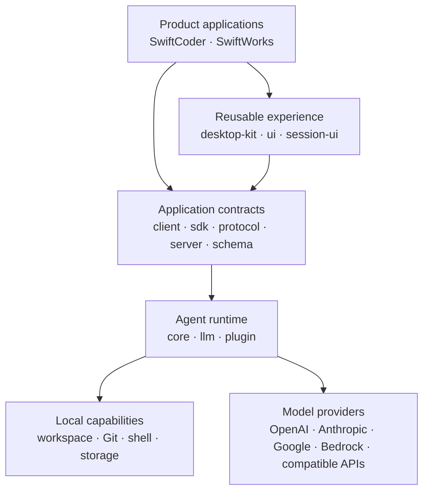

# SwiftCore

**A shared, local-first agent runtime for building inspectable AI applications.**

[](https://github.com/swift-scale-ai/swiftcore/actions/workflows/verify.yml)
[](LICENSE)
[](https://www.typescriptlang.org/)
[](https://bun.sh/)
[](https://swift-scale.com)

[Architecture](#architecture) · [Packages](#package-map) · [Quick Start](#quick-start) · [Contributing](CONTRIBUTING.md)

SwiftCore is the product-neutral foundation behind
[SwiftCoder](https://github.com/swift-scale-ai/swiftcoder) and SwiftWorks. It
provides reusable schemas, protocols, sessions, permissions, tools, model
integration, plugins, storage, server APIs, desktop lifecycle primitives, and
interface components for agent-powered applications.

SwiftCore exists so products can share a reliable agent platform without
sharing product workflows or branding.

## Why SwiftCore

- **Local-first execution.** Workspace access, Git operations, shell commands,
  permissions, and session state remain explicit and inspectable.
- **Provider-neutral models.** A common model layer supports OpenAI, Anthropic,
  Google, Amazon Bedrock, Azure, OpenRouter, OpenAI-compatible endpoints, and
  other routed providers.
- **Controlled agents.** Sessions, tools, permissions, persistence, and server
  contracts are separate building blocks instead of hidden framework behavior.
- **Reusable product surface.** Desktop lifecycle, generated clients, plugins,
  themes, prompts, diffs, and session UI can be shared across focused products.
- **Strict dependency direction.** Products depend on SwiftCore; SwiftCore never
  imports product code.

## Architecture



The boundary is intentional:

```text
SwiftCoder ─┐
            ├──> SwiftCore
SwiftWorks ─┘

SwiftCore -X-> SwiftCoder / SwiftWorks
```

Product-specific workflows, copy, branding, and release logic stay in their
product repositories.

## Package Map

| Package | Responsibility |
| --- | --- |
| `@swiftscale/core` | Agent sessions, permissions, persistence, workspace tools, and runtime services |
| `@swiftscale/schema` | Product-neutral data contracts |
| `@swiftscale/protocol` | Shared server protocol |
| `@swiftscale/server` | Product-neutral server handlers |
| `@swiftscale/client` | Generated promise and Effect clients |
| `@swiftscale/sdk` | Extension and integration SDK |
| `@swiftscale/llm` | Model providers, protocols, routing, and model integration |
| `@swiftscale/plugin` | Plugin contracts and tool integration |
| `@swiftscale/desktop-kit` | Product identity, OAuth, deep links, updates, window state, and restartable sidecars |
| `@swiftscale/ui` | Reusable interface primitives, themes, icons, and localization |
| `@swiftscale/session-ui` | Agent timeline, messages, prompts, diffs, and session components |

Supporting packages provide HTTP recording, API code generation, Effect/SQLite
integration, and repository automation.

## Quick Start

### Requirements

- [Bun](https://bun.sh/) 1.3.14
- Node.js 22.19 or newer
- Git

```bash
git clone https://github.com/swift-scale-ai/swiftcore.git
cd swiftcore
bun install

# Validate repository boundaries and types
bun run check:boundaries
bun run typecheck

# Run package tests
bun run test
```

SwiftCore is a Bun workspace. Packages currently expose source entry points for
the sibling SwiftScale products; independent npm distribution is not yet the
primary consumption path.

## Project Status

SwiftCore is under active extraction and stabilization. The repository is open
for inspection and collaboration, but package APIs should be considered
pre-stable until versioned distribution begins.

Current migration work includes:

- moving remaining coding-specific compatibility code from `@swiftscale/core`
  into SwiftCoder;
- replacing the vendored promise client in `@swiftscale/session-ui` with
  generated exports from `@swiftscale/client`;
- tightening product-neutral package boundaries;
- preparing independently versioned packages and release automation.

See the repository issues and pull requests for work that is ready for
collaboration.

## Contributing

Contributions that strengthen shared runtime primitives, provider integration,
protocols, testing, documentation, and package boundaries are welcome.

Before opening a pull request:

```bash
bun run lint
bun run check:boundaries
bun run typecheck
bun run test
```

Read [CONTRIBUTING.md](CONTRIBUTING.md) and
[CODE_OF_CONDUCT.md](CODE_OF_CONDUCT.md) before contributing. Please report
security vulnerabilities privately according to [SECURITY.md](SECURITY.md).

## License and Attribution

SwiftCore is released under the [MIT License](LICENSE). Upstream attribution,
font licensing, and complete third-party license texts are recorded in
[THIRD_PARTY_NOTICES.md](THIRD_PARTY_NOTICES.md) and [`legal/`](legal/).
Product names and artwork are governed by [TRADEMARKS.md](TRADEMARKS.md).

---

Built by [SwiftScale](https://swift-scale.com) for focused, transparent, and
portable agent-powered products.
